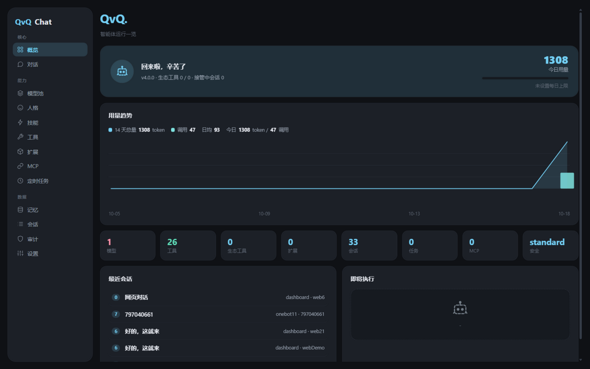
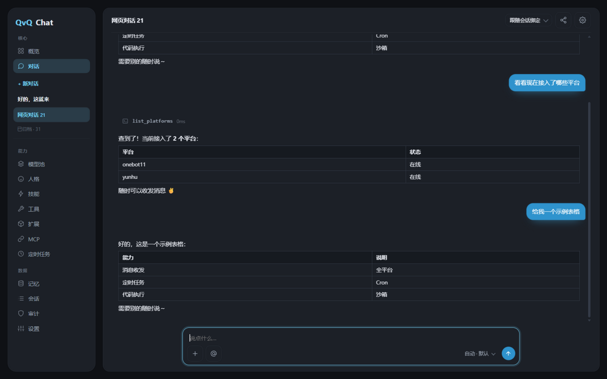
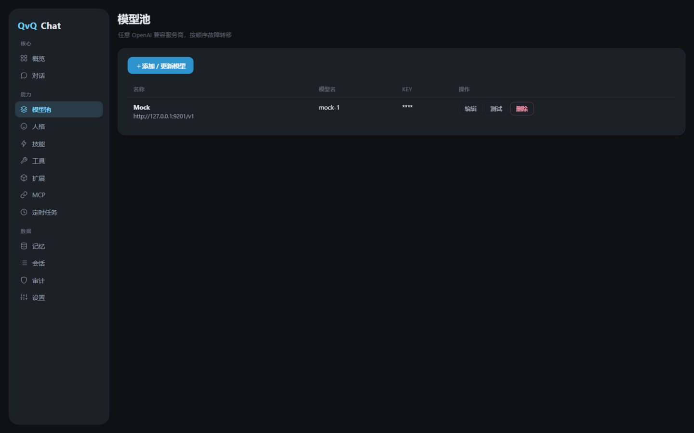
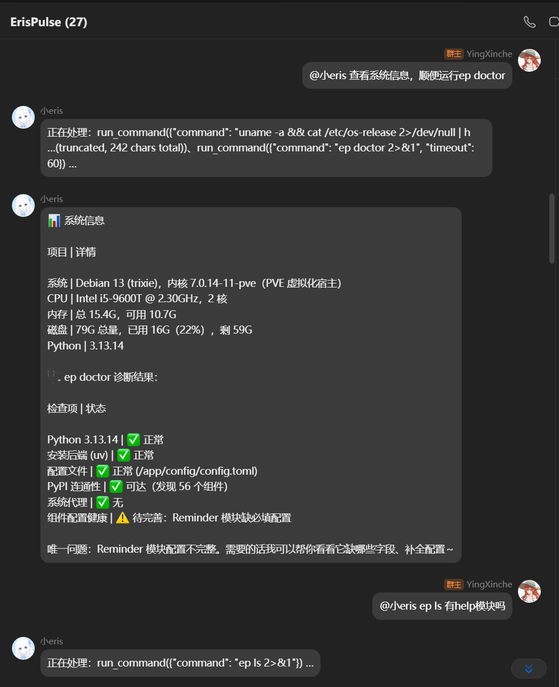

<div align="center">

[简体中文](./README.md) | English


# QvQChat

**One agent for everything.**

<p>
  <a href="https://pypi.org/project/ErisPulse-QvQChat/"></a>
  <a href="https://pypi.org/project/ErisPulse-QvQChat/"></a>
  <a href="https://github.com/wsu2059q/ErisPulse-QvQChat/pkgs/container/erispulse-qvqchat"></a>
  <a href="./LICENSE"></a>
  <a href="https://github.com/ErisPulse/ErisPulse"></a>
</p>



</div>

---

A universal agent module built on [ErisPulse](https://github.com/ErisPulse/ErisPulse). Built around a tool-use loop: send/receive messages, call ecosystem module services, write and run code, control your computer, generate images and speech, manage scheduled tasks and long-term memory — all through a single tool protocol.

## Interface

| Chat | Models |
|---|---|
|  |  |

The chat page supports streaming output, serial tool-call timelines, Markdown tables and code highlighting, a send staging queue, and stop generation. The sidebar manages sessions (pin / archive / AI-generated names / running indicator). The web and chat platforms share the same pipeline — tasks initiated on the chat side are visible in real time on the web and can be stopped directly.

## Core Features

The agent comes with a full toolkit: multi-platform messaging, tool-use reasoning, code / shell execution, file I/O, image generation, speech synthesis, vision, MCP, long-term memory, scheduled tasks, personas, session takeover, and a three-level security sandbox. Here's what sets it apart:

**Streaming + Resumable**

SSE word-by-word output with serial tool timelines. Refresh the browser or switch away and come back — running tasks automatically reconnect. Stop mid-generation with partial output preserved.

**Unified Pipeline**

Tasks initiated on QQ / Yunhu and other chat platforms are visible in real time on the web — tool calls, streaming text, and a remote stop button. One pipeline, two entry points.

**Ecosystem as Capability**

Installed ErisPulse modules that declare `services` automatically become agent tools. Optional `qvq_personas` / `qvq_schemas` for deep persona and schema integration. Install or uninstall modules — capabilities change instantly.

**Sub-agents**

`spawn_agent` dispatches an isolated sub-agent to explore a task independently and report back only the conclusion — keeping the main conversation memory clean.

**In-process Execution**

`run_python_sdk` runs Python directly in the main process with access to sdk / adapter / storage runtime objects. No subprocess needed.

**Context Compression**

Older messages auto-summarized when estimated tokens exceed the threshold (default 128000, customizable). Long tasks won't blow up the context.

**Share Sessions**

Generate a temporary read-only link (configurable expiry and token budget) for anyone to view the conversation. Export to Markdown.

**Smart Details**

AI-generated session names, content-hash attachment deduplication, Ctrl+V paste screenshots, auto-merge-forward for long replies, and truncated-response self-healing continuation.

<div align="center">

### Social Platforms



</div>

<div align="center">


</div>

## Installation

```bash
epsdk install ErisPulse-QvQChat
```

or

```bash
pip install ErisPulse-QvQChat
```

or Docker:

```bash
docker run -d --name qvqchat -p 8000:8000 ghcr.io/wsu2059qq/erispulse-qvqchat:latest
```

## Quick Start

1. Open the QvQChat view in the Dashboard, add an OpenAI-compatible model in "Models"
2. DM the bot, or @ it in a group, to start chatting
3. Install ecosystem modules (image gen, Cron, etc.) for additional capabilities

Chat commands:

| Command | Description |
|---|---|
| `/agent` | Show help |
| `/agent reset` | Reset current session context |
| `/agent persona [id]` | View or switch persona |
| `/agent tasks` | View scheduled tasks |
| `/agent status` | Status summary |
| `/agent takeover [min]` | Take over session (admin) |
| `/agent release` | Release takeover |

## Computer Security

| Level | Behavior |
|---|---|
| `strict` | No commands or code execution; read-only file ops in whitelisted dirs |
| `standard` (default) | Dangerous commands confirmed in chat; file access in whitelist |
| `permissive` | No execution or path restrictions; all operations audited |

## Tool Permission Model

- **Safe set (all users)**: send_message / send_dsl, platform query, memory, read_file / list_dir, scheduled tasks (executed with creator’s permission)
- **Admin-only**: run_command, run_python, run_python_sdk, spawn_agent, write_file, call_adapter_api, call_module, session takeover, all `eco_*` / `mcp_*`

Enable `owner_only` to restrict the agent to the framework owner. Enable `trust_agent` to skip confirmations (still audited).

## Extension

> See [docs/inter-module-en.md](./docs/inter-module-en.md) for details.

QvQChat extensions are plain ErisPulse modules:

**Layer 1 (automatic)**: Declare `services` in `get_meta()` — each service becomes an agent tool.

**Layer 2 (optional, each independent)**: Implement `qvq_personas()` or `qvq_schemas()` for deep integration.

```python
from ErisPulse.Core.Bases import BaseModule, ModuleMeta

class Main(BaseModule):
    @staticmethod
    def get_meta() -> ModuleMeta:
        return ModuleMeta(name="Draw", services=[
            {"name": "draw", "description": "Generate an image from a text prompt"},
        ])

    async def draw(self, prompt: str, size: str = "1024x1024"):
        return {"image_url": "https://..."}
```

## Config

Full configuration reference in the [Chinese README](./README.md) (Chinese table). All fields editable via Dashboard Settings.

## License

[MIT](./LICENSE)
