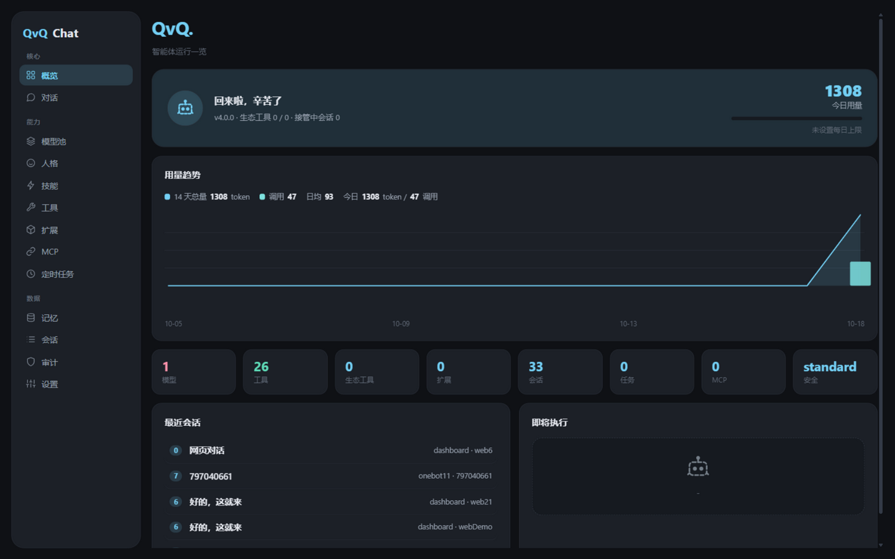
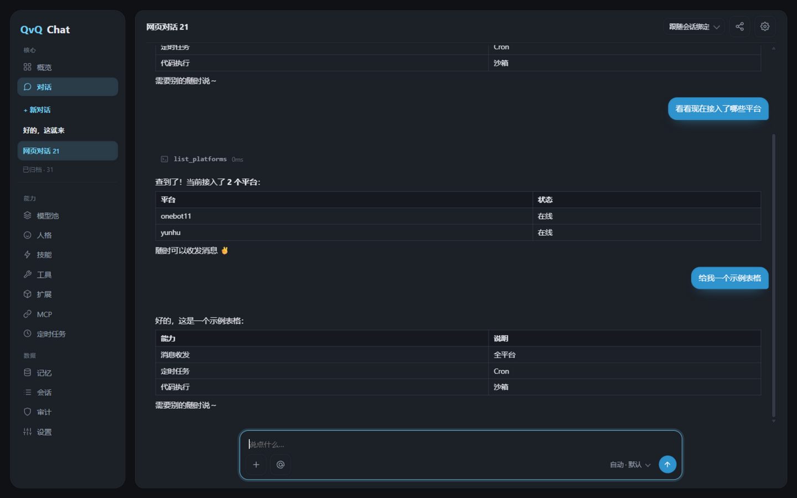
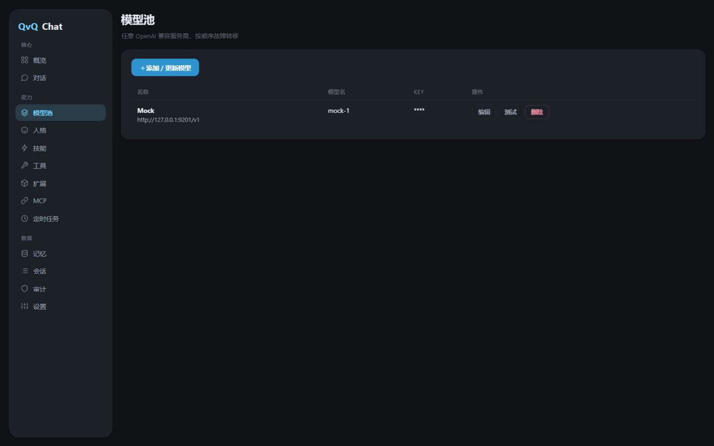

<div align="center">

[简体中文](README.md) | [繁體中文](README.zh-TW.md) | English | [日本語](README.ja.md) | [Русский](README.ru.md)


</div>

# QvQChat

**A general-purpose agent module for ErisPulse: chat on the platforms your bot lives on, call tools, write and run code, schedule tasks, and keep long-term memory.**

Works with any OpenAI-compatible model. Through installed adapters the model can send and receive messages, call services of other modules, read and write files, run commands and create scheduled tasks. Available tools depend on what is installed, and modules can be added or removed without restarting. A built-in web console shares the same execution pipeline with the chat side.

<p>

  <a href="https://github.com/ErisPulse/ErisPulse"></a>
  <a href="https://pypi.org/project/ErisPulse-QvQChat/"></a>
  <a href="https://pypi.org/project/ErisPulse-QvQChat/"></a>
  <a href="https://github.com/wsu2059q/ErisPulse-QvQChat/actions/workflows/ci.yml"></a>
  <a href="https://github.com/wsu2059q/ErisPulse-QvQChat/pkgs/container/erispulse-qvqchat"></a>
  <a href="./LICENSE"></a>

</p>



## Install

Requires Python 3.10+, ErisPulse >= 2.8.0 and at least one platform adapter.

```bash
epsdk install ErisPulse-QvQChat
# or
pip install ErisPulse-QvQChat
```

Docker:

```bash
docker run -d --name qvqchat -p 8000:8000 --restart unless-stopped ghcr.io/wsu2059q/erispulse-qvqchat:latest
```

## Quick start

1. Install the module and an adapter, e.g. `epsdk install ErisPulse-OneBotAdapter`.
2. Open the web console and add an OpenAI-compatible model (name, base URL, API key, model id).
3. Configure administrators:

```toml
[QvQChat]
admins = ["123456"]   # your user id on the chat platform
```

4. Visit `http://<host>:8000/QvQChat/view`, or use the Dashboard sidebar entry. With Dashboard installed its token is reused; standalone mode prints an access token in the startup log, which can also be configured.
5. Message the bot privately, or @ it in a group.

## Commands

The main command is `/qvq` (alias `/qvqchat`).

| Command | Access | Description |
|---|---|---|
| `/qvq` | everyone | Interactive menu |
| `/qvq card persona\|tasks\|usage` | everyone | Generate persona / task / usage cards |
| `/qvq status` · `/qvq whoami` | everyone | Status · identity and permission check |
| `/qvq todo` | everyone | View and complete todos |
| `/qvq quota` | everyone | View your own usage |
| `/qvq rewind [n]` | everyone (max 6) | Rewind the last messages |
| `/qvq persona [id]` | admin | View / switch persona |
| `/qvq reset` · `/qvq compact` | admin | Reset session · compact context now |
| `/qvq trigger [mode]` | admin | Trigger rule: all / at_only / lurk / off |
| `/qvq listen on\|off` | admin | Whether this chat feeds observation events |
| `/qvq mute` · `/qvq unmute` | admin | Mute / unmute this chat |
| `/qvq policy high\|normal\|low` | admin | Session resource priority |
| `/qvq lowtoken on\|off` | admin | Per-session budget mode |
| `/qvq subjobs` · `/qvq health` | admin | Background jobs / run health check |
| `/qvq takeover [minutes]` · `/qvq release` | admin | Take over / release the session |
| `/qvq memories clear profile\|facts` | owner | Clear profile / facts |

## Features

- **Tool loop**: messaging, platform APIs, files, shell and Python execution, memory, knowledge base, scheduled tasks, personas. Multi-step work can be delegated to a sub-agent with an isolated session, including background execution with automatic reporting.
- **Model pool**: any OpenAI-compatible endpoint, organized by provider, with failover, capability matching, vision delegation, cost estimation and usage records. Providers or individual models can be disabled temporarily.
- **Context**: long sessions are compacted into summaries with fact extraction; manual compaction and rewind supported.
- **Group chat**: trigger rules, wake prefixes, split replies, merged forwarding, quoted replies; personas bound per group or member.
- **Memory**: per-session long-term memory and cross-session user profiles; knowledge base with keyword triggers and semantic search (with embeddings configured).
- **Scheduled tasks**: created in natural language, four formats (cron / at / in / every), execution history available.
- **Extensions**: any service declared by an ErisPulse module becomes a tool automatically.
- **Multi-account**: several bot accounts on one platform with isolated sessions.
- **Budget mode**: global switch favoring cheaper models and smaller input for high-traffic setups.

## Web console

 

Streaming replies with per-tool steps and the ability to stop a running task; sessions can be pinned, archived, renamed and shared read-only. Management pages cover model pool, personas, knowledge base, skills, tools, MCP, scheduled tasks, memory, sessions, audit and storage. OpenAI-compatible endpoints `GET /v1/models` and `POST /v1/chat/completions` (streaming included) are also available.

## Extending

Modules declaring `services` in `get_meta()` expose each service as a tool automatically:

```python
from ErisPulse.Core.Bases import BaseModule, ModuleMeta

class Main(BaseModule):
    @staticmethod
    def get_meta() -> ModuleMeta:
        return ModuleMeta(name="Draw", services=[
            {"name": "draw", "description": "Generate an image from a prompt, return its URL"},
        ])

    async def draw(self, prompt: str, size: str = "1024x1024"):
        return {"image_url": "https://..."}
```

Optional convention services: `qvq_personas()` (persona presets), `qvq_schemas()` (parameter schemas), `qvq_settings()` (settings entries), `qvq_access()` (service access level). Modules may also subscribe to lifecycle events such as `qvq.message`, `qvq.replied` and `qvq.observe`.

## Companion plugins

- [ErisPulse-QvQStalker](https://github.com/wsu2059q/ErisPulse-QvQStalker): passive group observation and participation decisions.
- [ErisPulse-QvQMemes](https://github.com/wsu2059q/ErisPulse-QvQMemes): sticker library with automatic labeling and semantic selection.

## Configuration

All settings live under the `QvQChat` section and can be edited in the Dashboard settings page, grouped and documented per key.

## Development

```bash
git clone https://github.com/wsu2059q/ErisPulse-QvQChat
cd ErisPulse-QvQChat
pip install -e .[test]
pytest
```

See [CHANGELOG.md](CHANGELOG.md) for changes and [ARCHITECTURE.md](ARCHITECTURE.md) for internals.

## Community

Questions and suggestions: [Issues](https://github.com/wsu2059q/ErisPulse-QvQChat/issues).

- Telegram: <https://t.me/ErisPulse>
- QQ group: <https://qm.qq.com/q/TOwnCmypcy>

## License

[MIT](LICENSE)
