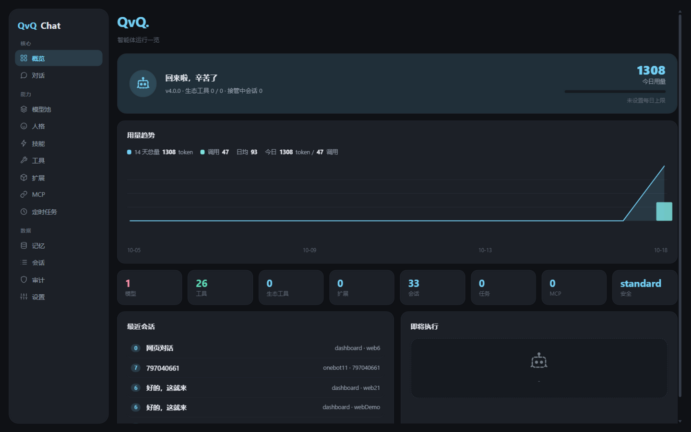
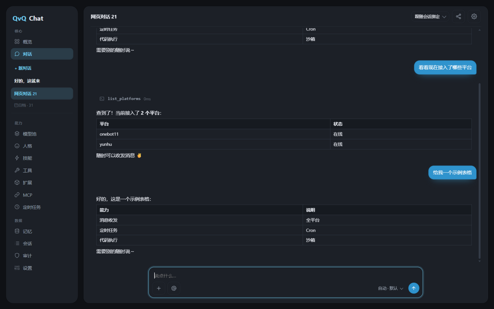
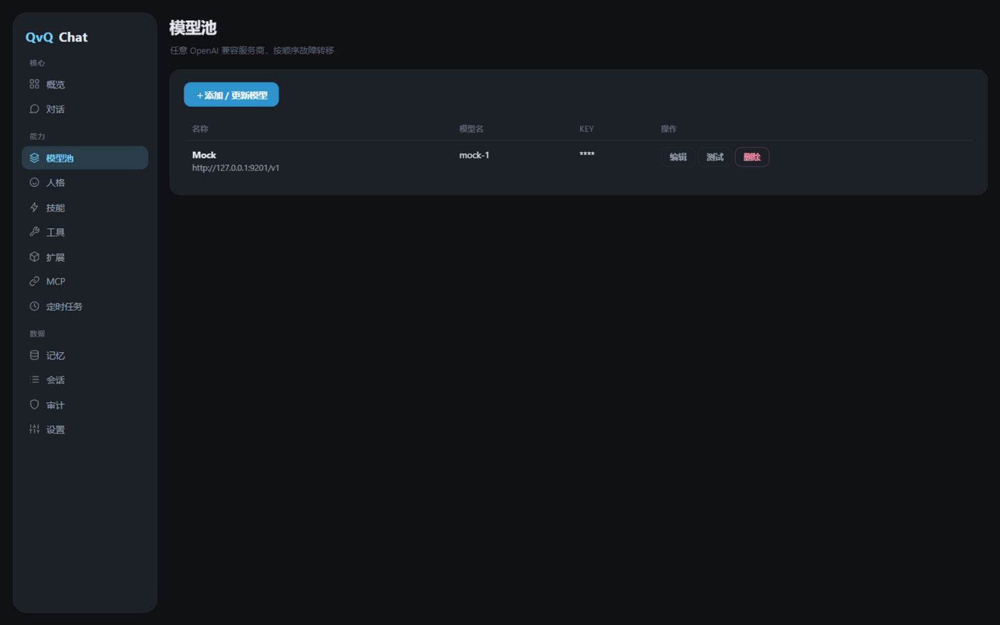

<div align="center">

[简体中文](README.md) | [繁體中文](README.zh-TW.md) | [English](README.en.md) | **日本語** | [Русский](README.ru.md)


</div>

# QvQChat

**ErisPulse 用の汎用エージェントモジュール：ボットが参加しているプラットフォームで会話し、ツールを呼び、コードを書いて実行し、定期タスクを組み、長期記憶を保ちます。**

任意の OpenAI 互換モデルを接続するだけで使えます。インストール済みのアダプターを通じて、メッセージの送受信、他モジュールのサービス呼び出し、ファイルの読み書き、コマンド実行、定期タスクの作成が可能です。使えるツールは導入状況に依存し、モジュールの追加・削除に再起動は不要です。Web コンソールを内蔵し、チャット側と Web 側は同じ実行経路を共有します。

<p>

  <a href="https://github.com/ErisPulse/ErisPulse"></a>
  <a href="https://pypi.org/project/ErisPulse-QvQChat/"></a>
  <a href="https://pypi.org/project/ErisPulse-QvQChat/"></a>
  <a href="https://github.com/wsu2059q/ErisPulse-QvQChat/actions/workflows/ci.yml"></a>
  <a href="https://github.com/wsu2059q/ErisPulse-QvQChat/pkgs/container/erispulse-qvqchat"></a>
  <a href="./LICENSE"></a>

</p>



## インストール

Python 3.10+、ErisPulse >= 2.8.0、およびプラットフォームアダプターが 1 つ以上必要です。

```bash
epsdk install ErisPulse-QvQChat
# または
pip install ErisPulse-QvQChat
```

Docker:

```bash
docker run -d --name qvqchat -p 8000:8000 --restart unless-stopped ghcr.io/wsu2059q/erispulse-qvqchat:latest
```

## クイックスタート

1. モジュールとアダプターをインストールします（例: `epsdk install ErisPulse-OneBotAdapter`）。
2. Web コンソールを開き、モデルプール画面で OpenAI 互換モデルを追加します（名前、Base URL、API Key、モデル名）。
3. 管理者を設定します:

```toml
[QvQChat]
admins = ["123456"]   # チャットプラットフォームでのあなたのユーザー id
```

4. `http://<host>:8000/QvQChat/view` にアクセスするか、Dashboard のサイドバーから開きます。Dashboard 導入時はそのトークンを再利用し、単体動作時はアクセストークンが起動ログに出力されます（設定も可能）。
5. ボットに DM するか、グループで @ します。

## コマンド

メインコマンドは `/qvq`（別名 `/qvqchat`）。

| コマンド | 権限 | 内容 |
|---|---|---|
| `/qvq` | 全員 | インタラクティブメニュー |
| `/qvq card persona\|tasks\|usage` | 全員 | ペルソナ / タスク / 使用量カードを生成 |
| `/qvq status` · `/qvq whoami` | 全員 | 稼働状況 · 権限診断 |
| `/qvq todo` | 全員 | ToDo の確認と完了 |
| `/qvq quota` | 全員 | 自分の使用量を確認 |
| `/qvq rewind [n]` | 全員（最大 6） | 直近のメッセージを巻き戻す |
| `/qvq persona [id]` | 管理者 | ペルソナの確認 / 切り替え |
| `/qvq reset` · `/qvq compact` | 管理者 | セッションリセット · 即時圧縮 |
| `/qvq trigger [mode]` | 管理者 | トリガールール: all / at_only / lurk / off |
| `/qvq listen on\|off` | 管理者 | このチャットの傍聴可否 |
| `/qvq mute` · `/qvq unmute` | 管理者 | このチャットのミュート / 解除 |
| `/qvq policy high\|normal\|low` | 管理者 | セッションのリソース優先度 |
| `/qvq lowtoken on\|off` | 管理者 | セッション単位の節約モード |
| `/qvq subjobs` · `/qvq health` | 管理者 | バックグラウンドタスク / 即時ヘルスチェック |
| `/qvq takeover [分]` · `/qvq release` | 管理者 | セッションの引き継ぎ / 解放 |
| `/qvq memories clear profile\|facts` | オーナー | プロファイル / 事実の消去 |

## 機能

- **ツールループ**: メッセージ送受信、プラットフォーム API、ファイル、シェルと Python の実行、長期記憶、知識ベース、定期タスク、ペルソナ。複数ステップの作業は独立セッションのサブエージェントに委任でき、バックグラウンド実行と結果の自動報告に対応します。
- **モデルプール**: 任意の OpenAI 互換エンドポイントをプロバイダー単位で管理。フェイルオーバー、能力マッチング、視覚モデルへの委任、コスト試算と使用量記録に対応。プロバイダーや個別モデルを一時的に無効化できます。
- **コンテキスト**: 長いセッションは要約に圧縮され事実も抽出されます。手動圧縮と巻き戻しも可能です。
- **グループチャット**: トリガールール、ウェイクプレフィックス、分割返信、まとめ転送、引用返信。ペルソナはグループ単位・メンバー単位で紐付けできます。
- **記憶**: セッション単位の長期記憶と、セッションを跨ぐユーザープロファイル。知識ベースはキーワードトリガーとセマンティック検索（embedding 設定時）に対応。
- **定期タスク**: 自然言語で作成、cron / at / in / every の 4 形式、実行履歴を確認可能。
- **拡張**: ErisPulse モジュールが宣言したサービスは自動的にツールになります。
- **マルチアカウント**: 同一プラットフォームの複数ボットアカウントでセッションを分離できます。
- **節約モード**: グローバルスイッチ。安価なモデルを優先し入力を圧縮します。

## コンソール

 

ストリーミング応答とツール呼び出しの段階表示、実行中タスクの停止。セッションのピン留め・アーカイブ・改名・読み取り専用共有に対応。管理画面はモデルプール、ペルソナ、知識ベース、スキル、ツール、MCP、定期タスク、記憶、セッション、監査、ストレージを網羅します。`GET /v1/models` と `POST /v1/chat/completions`（ストリーミング対応）の OpenAI 互換エンドポイントも提供します。

## 拡張

`get_meta()` で `services` を宣言すると、各サービスがツールになります:

```python
from ErisPulse.Core.Bases import BaseModule, ModuleMeta

class Main(BaseModule):
    @staticmethod
    def get_meta() -> ModuleMeta:
        return ModuleMeta(name="Draw", services=[
            {"name": "draw", "description": "説明から画像を生成し URL を返す"},
        ])

    async def draw(self, prompt: str, size: str = "1024x1024"):
        return {"image_url": "https://..."}
```

任意の規約サービス: `qvq_personas()`（ペルソナプリセット）、`qvq_schemas()`（パラメータ Schema）、`qvq_settings()`（設定項目）、`qvq_access()`（サービス公開レベル）。`qvq.message`、`qvq.replied`、`qvq.observe` などのライフサイクルイベントも購読できます。

## 関連プラグイン

- [ErisPulse-QvQStalker](https://github.com/wsu2059q/ErisPulse-QvQStalker): グループ傍聴と参加判断。
- [ErisPulse-QvQMemes](https://github.com/wsu2059q/ErisPulse-QvQMemes): スタンプライブラリ。自動収集・タグ付け・意味検索。

## 設定

すべての設定は `QvQChat` セクションにあり、Dashboard の設定ページでグループ別に編集できます（各項目に説明付き）。

## 開発

```bash
git clone https://github.com/wsu2059q/ErisPulse-QvQChat
cd ErisPulse-QvQChat
pip install -e .[test]
pytest
```

変更履歴は [CHANGELOG.md](CHANGELOG.md)、内部構造は [ARCHITECTURE.md](ARCHITECTURE.md) を参照してください。

## コミュニティ

質問・提案は [Issues](https://github.com/wsu2059q/ErisPulse-QvQChat/issues) へ。

- Telegram: <https://t.me/ErisPulse>
- QQ グループ: <https://qm.qq.com/q/TOwnCmypcy>

## ライセンス

[MIT](LICENSE)
