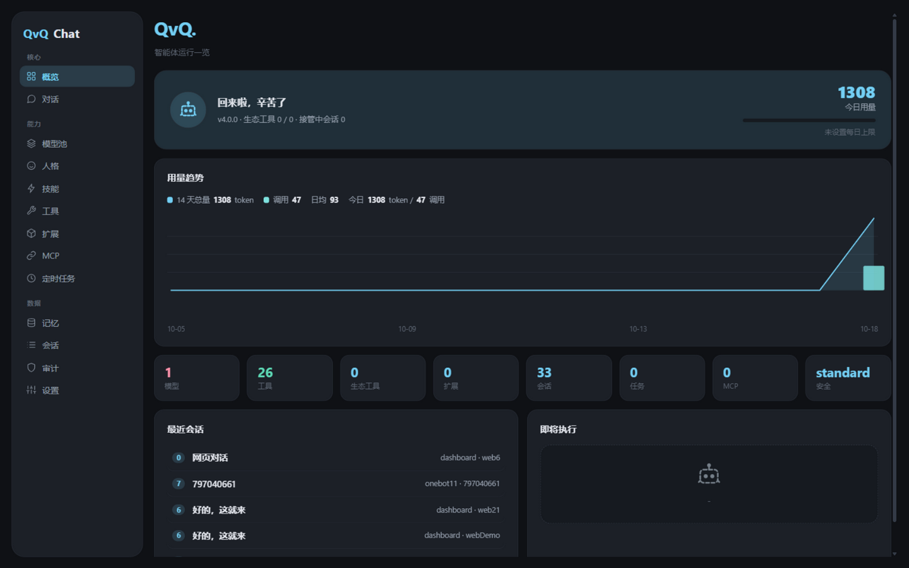
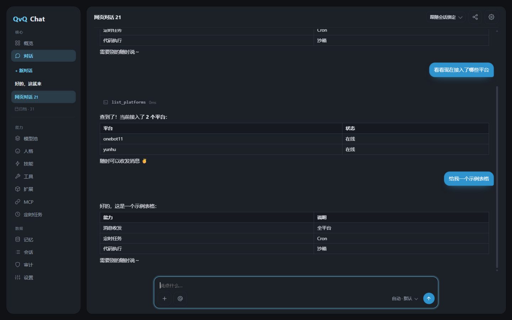
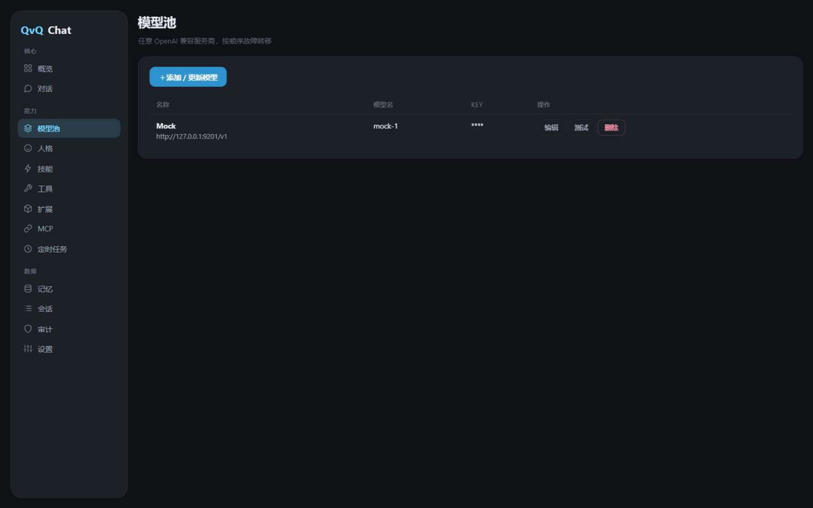

<div align="center">

简体中文 | [繁體中文](README.zh-TW.md) | [English](README.en.md) | [日本語](README.ja.md) | [Русский](README.ru.md)


</div>

# QvQChat

**ErisPulse 的通用智能体模块：在机器人所在的平台上聊天、调用工具、写代码并执行、安排定时任务、维护长期记忆。**

接上任意 OpenAI 兼容模型即可使用。模型可经已安装的适配器收发消息、调用其它模块的服务、读写文件、执行命令、创建定时任务。可用工具取决于安装了什么，模块装卸无需重启。自带网页控制台，聊天侧与网页侧共用同一条执行链路。

<p>

  <a href="https://github.com/ErisPulse/ErisPulse"></a>
  <a href="https://pypi.org/project/ErisPulse-QvQChat/"></a>
  <a href="https://pypi.org/project/ErisPulse-QvQChat/"></a>
  <a href="https://github.com/wsu2059q/ErisPulse-QvQChat/actions/workflows/ci.yml"></a>
  <a href="https://github.com/wsu2059q/ErisPulse-QvQChat/pkgs/container/erispulse-qvqchat"></a>
  <a href="./LICENSE"></a>

</p>



## 安装

要求 Python 3.10+、ErisPulse >= 2.8.0，以及至少一个平台适配器。

```bash
epsdk install ErisPulse-QvQChat
# 或
pip install ErisPulse-QvQChat
```

Docker：

```bash
docker run -d --name qvqchat -p 8000:8000 --restart unless-stopped ghcr.io/wsu2059q/erispulse-qvqchat:latest
```

## 快速开始

1. 安装模块与一个适配器，例如 `epsdk install ErisPulse-OneBotAdapter`。
2. 打开网页控制台，在模型池页添加一个 OpenAI 兼容模型（名称、Base URL、API Key、模型名）。
3. 配置管理员（聊天侧的管理员权限来源）：

```toml
[QvQChat]
admins = ["123456"]   # 你在聊天平台上的用户 id
```

4. 访问 `http://<host>:8000/QvQChat/view`，或从 Dashboard 侧边栏进入。装有 Dashboard 时复用其登录令牌；独立运行时访问令牌会打印在启动日志中，也可自行配置。
5. 私聊机器人，或在群里 @ 它。

## 命令

主命令为 `/qvq`（别名 `/qvqchat`），子命令同时接受中英文写法。

| 命令 | 权限 | 作用 |
|---|---|---|
| `/qvq` | 所有人 | 交互式菜单 |
| `/qvq card persona\|tasks\|usage` | 所有人 | 生成人格 / 任务 / 用量卡片 |
| `/qvq status` · `/qvq whoami` | 所有人 | 运行概况 · 身份与权限诊断 |
| `/qvq todo` | 所有人 | 查看待办，标记完成 |
| `/qvq quota` | 所有人 | 查看自己的用量 |
| `/qvq rewind [n]` | 所有人（上限 6） | 回溯最近若干条消息 |
| `/qvq persona [id]` | 管理员 | 查看 / 切换人格 |
| `/qvq reset` · `/qvq compact` | 管理员 | 重置会话 · 立即压缩上下文 |
| `/qvq trigger [模式]` | 管理员 | 设置触发规则：all / at_only / lurk / off |
| `/qvq listen on\|off` | 管理员 | 本会话是否参与旁听 |
| `/qvq mute` · `/qvq unmute` | 管理员 | 屏蔽 / 解除屏蔽本会话 |
| `/qvq policy high\|normal\|low` | 管理员 | 会话资源优先级 |
| `/qvq lowtoken on\|off` · `/qvq budget <n>` | 管理员 | 会话级低token模式 / 会话日限额（0 不限） |
| `/qvq subjobs` · `/qvq health` | 管理员 | 后台任务列表 / 立即体检 |
| `/qvq takeover [分钟]` · `/qvq release` | 管理员 | 接管 / 释放会话 |
| `/qvq memories clear profile\|facts` | 主人 | 清空画像 / 事实 |

## 能力

- **工具循环**：消息收发、平台 API、文件、命令与 Python 执行、长期记忆、知识库、定时任务、人格。多步任务可派发给独立会话的子智能体，支持后台执行与结果回报。
- **模型池**：任意 OpenAI 兼容接口，按提供商组织，支持故障转移、能力匹配、视觉代述、成本估算与用量记录。可临时停用某家提供商或某个模型。
- **上下文**：长会话自动压缩为摘要并抽取事实；可手动压缩、回溯。
- **群聊**：触发规则、唤醒前缀、分段回复、合并转发、引用回复；人格可按群、按成员绑定。
- **记忆**：会话级长期记忆与跨会话用户画像；知识库支持关键词触发与语义检索（配置 embedding 后）。
- **定时任务**：自然语言创建，支持 cron / at / in / every 四种格式，执行记录可查。
- **扩展**：任何 ErisPulse 模块声明的服务都会成为智能体的工具，装上即生效。
- **多账户**：平台的多个 bot 账户可独立隔离会话。
- **低token模式**：全局开关或会话级叠加，也可超限自动进入；系统提示与历史轻量化、辅助调用走便宜链路，适合高流量场景。

## 网页控制台

 

对话页流式输出，工具调用逐步展示，可中止运行中的任务；会话支持置顶、归档、改名与只读分享链接。管理页覆盖模型池、人格、知识库、技能、工具、MCP、定时任务、记忆、会话、审计与存储。另提供 OpenAI 兼容端点 `GET /v1/models` 与 `POST /v1/chat/completions`（含流式）。

## 扩展

模块在 `get_meta()` 里声明 `services`，每个服务自动成为工具：

```python
from ErisPulse.Core.Bases import BaseModule, ModuleMeta

class Main(BaseModule):
    @staticmethod
    def get_meta() -> ModuleMeta:
        return ModuleMeta(name="Draw", services=[
            {"name": "draw", "description": "根据描述生成图片，返回图片 URL"},
        ])

    async def draw(self, prompt: str, size: str = "1024x1024"):
        return {"image_url": "https://..."}
```

可选约定服务：`qvq_personas()` 提供人格预设，`qvq_schemas()` 提供参数 Schema，`qvq_settings()` 声明配置项（渲染到设置页），`qvq_access()` 声明服务访问级别。模块也可订阅 `qvq.message`、`qvq.replied`、`qvq.observe` 等生命周期事件。

## 配套插件

- [ErisPulse-QvQStalker](https://github.com/wsu2059q/ErisPulse-QvQStalker)：群聊旁听与参与决策，自行判断何时插话。
- [ErisPulse-QvQMemes](https://github.com/wsu2059q/ErisPulse-QvQMemes)：表情包库，自动收录打标，按语义挑选发送。

## 配置

全部配置位于 `QvQChat` 节，可在 Dashboard 设置页按分组修改，每项均有说明。

## 开发

```bash
git clone https://github.com/wsu2059q/ErisPulse-QvQChat
cd ErisPulse-QvQChat
pip install -e .[test]
pytest
```

变更记录见 [CHANGELOG.md](CHANGELOG.md)，内部结构见 [ARCHITECTURE.md](ARCHITECTURE.md)。

## 交流

问题与建议请提 [Issue](https://github.com/wsu2059q/ErisPulse-QvQChat/issues)。

- Telegram：<https://t.me/ErisPulse>
- QQ 群：<https://qm.qq.com/q/TOwnCmypcy>

## 许可证

[MIT](LICENSE)
