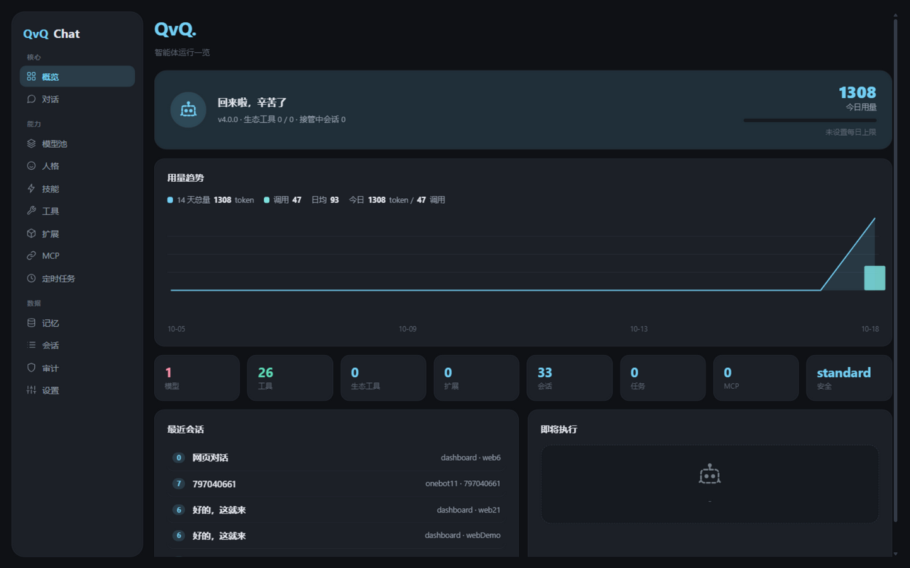
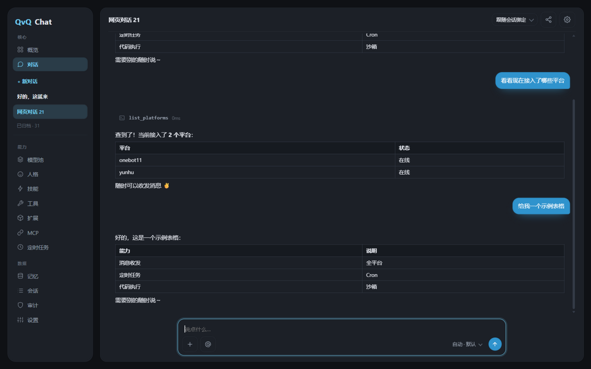
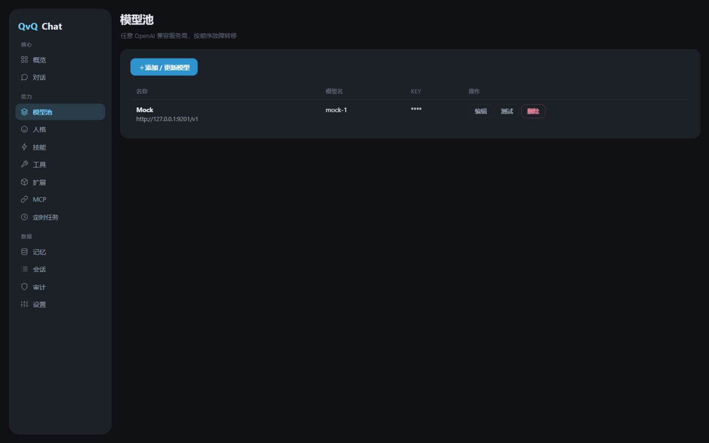

<div align="center">

[简体中文](README.md) | [繁體中文](README.zh-TW.md) | [English](README.en.md) | [日本語](README.ja.md) | **Русский**


</div>

# QvQChat

**Универсальный агентный модуль для ErisPulse: общение на платформах вашего бота, вызов инструментов, написание и запуск кода, планирование задач и долговременная память.**

Работает с любой OpenAI-совместимой моделью. Через установленные адаптеры модель может отправлять и получать сообщения, вызывать сервисы других модулей, читать и писать файлы, выполнять команды и создавать задачи по расписанию. Доступные инструменты зависят от установленного, модули добавляются и удаляются без перезапуска. Встроенная веб-консоль использует тот же конвейер выполнения, что и чат.

<p>

  <a href="https://github.com/ErisPulse/ErisPulse"></a>
  <a href="https://pypi.org/project/ErisPulse-QvQChat/"></a>
  <a href="https://pypi.org/project/ErisPulse-QvQChat/"></a>
  <a href="https://github.com/wsu2059q/ErisPulse-QvQChat/actions/workflows/ci.yml"></a>
  <a href="https://github.com/wsu2059q/ErisPulse-QvQChat/pkgs/container/erispulse-qvqchat"></a>
  <a href="./LICENSE"></a>

</p>



## Установка

Требуются Python 3.10+, ErisPulse >= 2.8.0 и хотя бы один платформенный адаптер.

```bash
epsdk install ErisPulse-QvQChat
# или
pip install ErisPulse-QvQChat
```

Docker:

```bash
docker run -d --name qvqchat -p 8000:8000 --restart unless-stopped ghcr.io/wsu2059q/erispulse-qvqchat:latest
```

## Быстрый старт

1. Установите модуль и адаптер, например `epsdk install ErisPulse-OneBotAdapter`.
2. Откройте веб-консоль и добавьте OpenAI-совместимую модель (название, Base URL, API key, id модели).
3. Настройте администраторов:

```toml
[QvQChat]
admins = ["123456"]   # ваш id на платформе
```

4. Откройте `http://<host>:8000/QvQChat/view` или пункт в боковой панели Dashboard. При установленном Dashboard используется его токен; в автономном режиме токен доступа печатается в логе запуска и может быть задан вручную.
5. Напишите боту в личку или упомяните его в группе.

## Команды

Основная команда — `/qvq` (алиас `/qvqchat`).

| Команда | Доступ | Назначение |
|---|---|---|
| `/qvq` | все | Интерактивное меню |
| `/qvq card persona\|tasks\|usage` | все | Карточки персоны / задач / расходов |
| `/qvq status` · `/qvq whoami` | все | Состояние · проверка прав |
| `/qvq todo` | все | Список задач и отметки |
| `/qvq quota` | все | Свой расход |
| `/qvq rewind [n]` | все (до 6) | Откат последних сообщений |
| `/qvq persona [id]` | админ | Просмотр / смена персоны |
| `/qvq reset` · `/qvq compact` | админ | Сброс сессии · сжатие контекста |
| `/qvq trigger [mode]` | админ | Правило срабатывания: all / at_only / lurk / off |
| `/qvq listen on\|off` | админ | Участие сессии в наблюдении |
| `/qvq mute` · `/qvq unmute` | админ | Заглушить / вернуть сессию |
| `/qvq policy high\|normal\|low` | админ | Приоритет ресурсов сессии |
| `/qvq lowtoken on\|off` | админ | Экономный режим сессии |
| `/qvq subjobs` · `/qvq health` | админ | Фоновые задачи / проверка состояния |
| `/qvq takeover [мин]` · `/qvq release` | админ | Перехват / освобождение сессии |
| `/qvq memories clear profile\|facts` | владелец | Очистить профиль / факты |

## Возможности

- **Цикл инструментов**: сообщения, API платформ, файлы, shell и Python, память, база знаний, задачи по расписанию, персоны. Многошаговую работу можно передать субагенту с изолированной сессией, включая фоновое выполнение с автоматическим отчётом.
- **Пул моделей**: любые OpenAI-совместимые эндпоинты по провайдерам, с отказоустойчивостью, подбором по возможностям, делегированием визуальных задач, оценкой стоимости и учётом расхода. Провайдера или модель можно временно отключить.
- **Контекст**: длинные сессии сжимаются в сводку с извлечением фактов; доступны ручное сжатие и откат.
- **Групповой чат**: правила срабатывания, префиксы, разбивка ответов, объединённая пересылка, цитирование; персоны привязываются к группе или участнику.
- **Память**: долговременная память сессии и межсессионные профили пользователей; база знаний с триггерами по ключевым словам и семантическим поиском (при настроенных embeddings).
- **Задачи по расписанию**: создаются на естественном языке, форматы cron / at / in / every, история выполнения доступна.
- **Расширения**: любой сервис, объявленный модулем ErisPulse, становится инструментом.
- **Мультиаккаунт**: несколько аккаунтов бота на одной платформе с изоляцией сессий.
- **Экономный режим**: глобальный переключатель, приоритет дешёвых моделей и меньший ввод.

## Веб-консоль

 

Потоковые ответы с пошаговым показом инструментов и остановкой выполняющейся задачи; сессии можно закреплять, архивировать, переименовывать и открывать по ссылке только для чтения. Разделы управления: пул моделей, персоны, база знаний, навыки, инструменты, MCP, задачи, память, сессии, аудит и хранилище. Также доступны OpenAI-совместимые эндпоинты `GET /v1/models` и `POST /v1/chat/completions` (с потоковой передачей).

## Расширение

Модуль объявляет `services` в `get_meta()`, и каждый сервис становится инструментом:

```python
from ErisPulse.Core.Bases import BaseModule, ModuleMeta

class Main(BaseModule):
    @staticmethod
    def get_meta() -> ModuleMeta:
        return ModuleMeta(name="Draw", services=[
            {"name": "draw", "description": "Сгенерировать изображение по описанию и вернуть URL"},
        ])

    async def draw(self, prompt: str, size: str = "1024x1024"):
        return {"image_url": "https://..."}
```

Необязательные соглашения: `qvq_personas()` (пресеты персон), `qvq_schemas()` (схемы параметров), `qvq_settings()` (элементы настроек), `qvq_access()` (уровень доступа сервиса). Модули также могут подписываться на события `qvq.message`, `qvq.replied`, `qvq.observe`.

## Плагины

- [ErisPulse-QvQStalker](https://github.com/wsu2059q/ErisPulse-QvQStalker): наблюдение за группой и решение об участии.
- [ErisPulse-QvQMemes](https://github.com/wsu2059q/ErisPulse-QvQMemes): библиотека стикеров с авторазметкой и семантическим поиском.

## Настройка

Все настройки находятся в секции `QvQChat` и редактируются на странице настроек Dashboard по группам, каждая с описанием.

## Разработка

```bash
git clone https://github.com/wsu2059q/ErisPulse-QvQChat
cd ErisPulse-QvQChat
pip install -e .[test]
pytest
```

История изменений — [CHANGELOG.md](CHANGELOG.md), внутреннее устройство — [ARCHITECTURE.md](ARCHITECTURE.md).

## Сообщество

Вопросы и предложения — в [Issues](https://github.com/wsu2059q/ErisPulse-QvQChat/issues).

- Telegram: <https://t.me/ErisPulse>
- QQ-группа: <https://qm.qq.com/q/TOwnCmypcy>

## Лицензия

[MIT](LICENSE)
