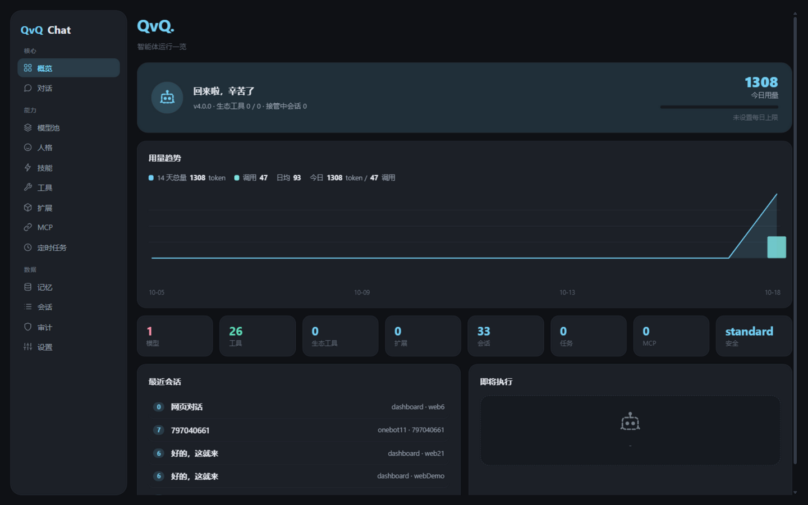
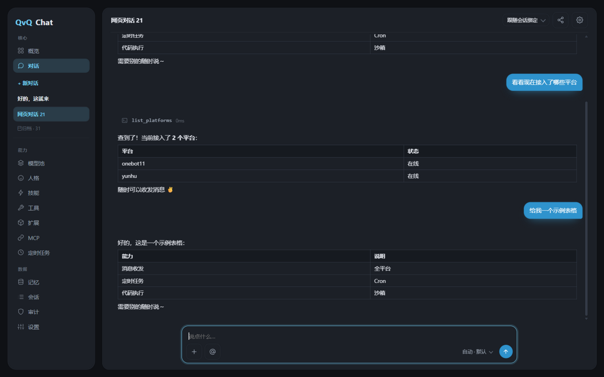
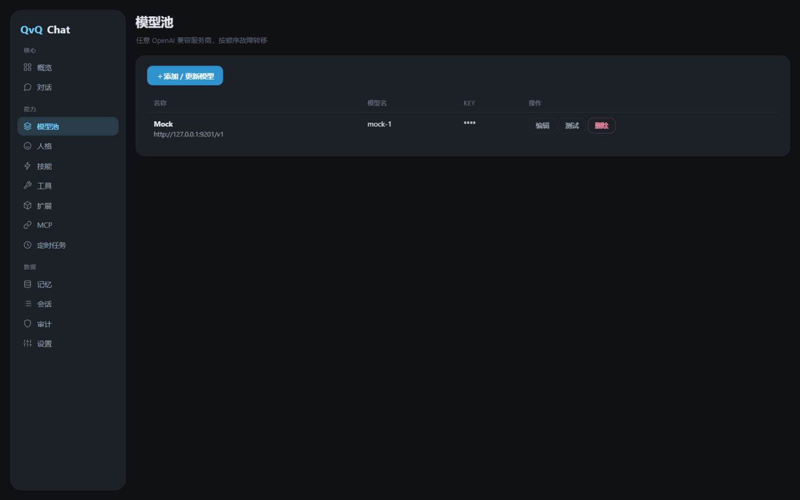

<div align="center">

[简体中文](README.md) | **繁體中文** | [English](README.en.md) | [日本語](README.ja.md) | [Русский](README.ru.md)


</div>

# QvQChat

**ErisPulse 的通用智能體模組：在機器人所在的平台上聊天、呼叫工具、寫程式並執行、安排定時任務、維護長期記憶。**

接上任意 OpenAI 相容模型即可使用。模型可經已安裝的適配器收發訊息、呼叫其它模組的服務、讀寫檔案、執行指令、建立定時任務。可用工具取決於安裝了什麼，模組裝卸無需重啟。內建網頁控制台，聊天側與網頁側共用同一條執行鏈路。

<p>

  <a href="https://github.com/ErisPulse/ErisPulse"></a>
  <a href="https://pypi.org/project/ErisPulse-QvQChat/"></a>
  <a href="https://pypi.org/project/ErisPulse-QvQChat/"></a>
  <a href="https://github.com/wsu2059q/ErisPulse-QvQChat/actions/workflows/ci.yml"></a>
  <a href="https://github.com/wsu2059q/ErisPulse-QvQChat/pkgs/container/erispulse-qvqchat"></a>
  <a href="./LICENSE"></a>

</p>



## 安裝

需要 Python 3.10+、ErisPulse >= 2.8.0，以及至少一個平台適配器。

```bash
epsdk install ErisPulse-QvQChat
# 或
pip install ErisPulse-QvQChat
```

Docker：

```bash
docker run -d --name qvqchat -p 8000:8000 --restart unless-stopped ghcr.io/wsu2059q/erispulse-qvqchat:latest
```

## 快速開始

1. 安裝模組與一個適配器，例如 `epsdk install ErisPulse-OneBotAdapter`。
2. 開啟網頁控制台，在模型池頁新增一個 OpenAI 相容模型（名稱、Base URL、API Key、模型名）。
3. 設定管理員：

```toml
[QvQChat]
admins = ["123456"]   # 你在聊天平台上的使用者 id
```

4. 存取 `http://<host>:8000/QvQChat/view`，或從 Dashboard 側邊欄進入。裝有 Dashboard 時沿用其登入權杖；獨立執行時存取權杖會印在啟動日誌中，也可自行設定。
5. 私訊機器人，或在群組裡 @ 它。

## 指令

主指令為 `/qvq`（別名 `/qvqchat`）。

| 指令 | 權限 | 作用 |
|---|---|---|
| `/qvq` | 所有人 | 互動式選單 |
| `/qvq card persona\|tasks\|usage` | 所有人 | 生成人格 / 任務 / 用量卡片 |
| `/qvq status` · `/qvq whoami` | 所有人 | 執行概況 · 身分與權限診斷 |
| `/qvq todo` | 所有人 | 查看待辦、標記完成 |
| `/qvq quota` | 所有人 | 查看自己的用量 |
| `/qvq rewind [n]` | 所有人（上限 6） | 回溯最近若干則訊息 |
| `/qvq persona [id]` | 管理員 | 查看 / 切換人格 |
| `/qvq reset` · `/qvq compact` | 管理員 | 重置會話 · 立即壓縮上下文 |
| `/qvq trigger [模式]` | 管理員 | 設定觸發規則：all / at_only / lurk / off |
| `/qvq listen on\|off` | 管理員 | 本會話是否參與旁聽 |
| `/qvq mute` · `/qvq unmute` | 管理員 | 封鎖 / 解除封鎖本會話 |
| `/qvq policy high\|normal\|low` | 管理員 | 會話資源優先級 |
| `/qvq lowtoken on\|off` | 管理員 | 會話級省錢模式 |
| `/qvq subjobs` · `/qvq health` | 管理員 | 背景任務列表 / 立即健檢 |
| `/qvq takeover [分鐘]` · `/qvq release` | 管理員 | 接管 / 釋放會話 |
| `/qvq memories clear profile\|facts` | 主人 | 清空畫像 / 事實 |

## 能力

- **工具循環**：訊息收發、平台 API、檔案、指令與 Python 執行、長期記憶、知識庫、定時任務、人格。多步任務可派發給獨立會話的子智能體，支援背景執行與結果回報。
- **模型池**：任意 OpenAI 相容介面，按提供商組織，支援故障轉移、能力匹配、視覺代述、成本估算與用量記錄。可臨時停用某家提供商或某個模型。
- **上下文**：長會話自動壓縮為摘要並抽取事實；可手動壓縮、回溯。
- **群聊**：觸發規則、喚醒前綴、分段回覆、合併轉發、引用回覆；人格可按群組、按成員綁定。
- **記憶**：會話級長期記憶與跨會話使用者畫像；知識庫支援關鍵詞觸發與語意檢索（設定 embedding 後）。
- **定時任務**：自然語言建立，支援 cron / at / in / every 四種格式，執行記錄可查。
- **擴充**：任何 ErisPulse 模組宣告的服務都會成為智能體的工具，裝上即生效。
- **多帳戶**：同一平台的多個 bot 帳戶可獨立隔離會話。
- **省錢模式**：全域開關，對話優先便宜模型並壓縮輸入，適合高流量場景。

## 網頁控制台

 

對話頁串流輸出，工具呼叫逐步展示，可中止執行中的任務；會話支援置頂、封存、改名與唯讀分享連結。管理頁涵蓋模型池、人格、知識庫、技能、工具、MCP、定時任務、記憶、會話、審計與儲存。另提供 OpenAI 相容端點 `GET /v1/models` 與 `POST /v1/chat/completions`（含串流）。

## 擴充

模組在 `get_meta()` 裡宣告 `services`，每個服務自動成為工具：

```python
from ErisPulse.Core.Bases import BaseModule, ModuleMeta

class Main(BaseModule):
    @staticmethod
    def get_meta() -> ModuleMeta:
        return ModuleMeta(name="Draw", services=[
            {"name": "draw", "description": "根據描述生成圖片，回傳圖片 URL"},
        ])

    async def draw(self, prompt: str, size: str = "1024x1024"):
        return {"image_url": "https://..."}
```

可選約定服務：`qvq_personas()` 提供人格預設，`qvq_schemas()` 提供參數 Schema，`qvq_settings()` 宣告設定項（渲染到設定頁），`qvq_access()` 宣告服務存取級別。模組也可訂閱 `qvq.message`、`qvq.replied`、`qvq.observe` 等生命週期事件。

## 配套外掛

- [ErisPulse-QvQStalker](https://github.com/wsu2059q/ErisPulse-QvQStalker)：群聊旁聽與參與決策，自行判斷何時插話。
- [ErisPulse-QvQMemes](https://github.com/wsu2059q/ErisPulse-QvQMemes)：表情包庫，自動收錄打標，按語意挑選傳送。

## 設定

全部設定位於 `QvQChat` 節，可在 Dashboard 設定頁按分組修改，每項均有說明。

## 開發

```bash
git clone https://github.com/wsu2059q/ErisPulse-QvQChat
cd ErisPulse-QvQChat
pip install -e .[test]
pytest
```

變更記錄見 [CHANGELOG.md](CHANGELOG.md)，內部結構見 [ARCHITECTURE.md](ARCHITECTURE.md)。

## 交流

問題與建議請提 [Issue](https://github.com/wsu2059q/ErisPulse-QvQChat/issues)。

- Telegram：<https://t.me/ErisPulse>
- QQ 群：<https://qm.qq.com/q/TOwnCmypcy>

## 授權

[MIT](LICENSE)
